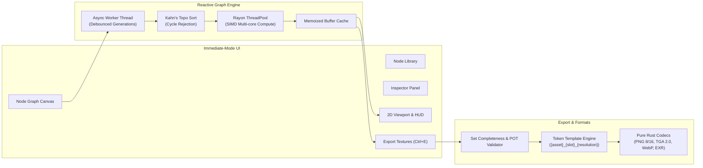

# ARKH TextureLab

> PBR Texture Pipeline Workstation — pack, convert, validate, and batch-export texture sets.

ARKH TextureLab is a native desktop workstation for technical artists and game developers. It handles PBR channel packing, lexical naming normalisation, format conversion, and batch export through a node-graph interface — all in a single portable executable.

---

## Highlights

* **100 % Pure Rust**: Built with `eframe` 0.31, `egui` 0.31, `egui_dock` 0.16, and `rayon`. Sub-100 ms cold startup, ~6 MB portable binary, zero runtime dependencies.
* **Topological DAG Evaluator**: Reactive node-graph execution via Kahn's topological sort with cycle detection, dirty-subgraph propagation, memoised cache, and 100-step undo/redo.
* **21 Node Types Across 9 Categories**: I/O, Constants, Channel Ops, Colour Adjust, Normal Ops, Blend Ops, Math (13 operations), Transform, and Utility (Comment Boxes & Reroute).
* **PBR Lexical Normaliser**: 60+ industry naming conventions (Megascans, Poly Haven, Substance, Quixel) with auto-role classification and one-click pack wizard.
* **Industry Export Presets**: Unreal Engine ORM, Unity HDRP MaskMap, Blender Principled, CryEngine, and custom token pipelines.
* **Dual Binary Engine**: GUI workstation (`texturelab.exe`) and headless automation runner (`texturelab-cli.exe`).
* **Codecs**: Lossless 8-bit and 16-bit PNG, TGA 2.0 with custom footer, WebP, JPEG, BMP, OpenEXR.
* **Canvas Navigation**: Unreal Engine Material Editor standard navigation: right-click pan, right-click tap spawn palette, Alt+Click wire cut, two-way wire drag, wire-drop auto-wire, and hold-key quick spawn.

---

## Architecture Overview



---

## Quickstart

### Windows Scripts
* [`setup.bat`](setup.bat) — Toolchain check, test suite, portable `.exe` build.
* [`run_desktop.bat`](run_desktop.bat) — Launch the portable workstation.

### Cargo Commands
```powershell
cargo run              # Debug workstation
cargo run --release    # Optimised release workstation
cargo test             # 241 unit + integration tests (All green)
cargo clippy -- -D warnings # Strict zero-warning quality gate
cargo build --release  # Portable executables → target/release/texturelab.exe & texturelab-cli.exe
```

---

## Hotkeys

Hotkeys are defined in [`src/hotkeys/mod.rs`](src/hotkeys/mod.rs).

| Shortcut | Action |
|---|---|
| `Tab` / Right-click tap | Open fuzzy search spawn palette at cursor |
| `F` | Frame camera on selection (or frame all nodes) |
| `Alt + Click` wire or pin | Sever connection |
| Wire double-click | Insert inline Reroute pin |
| `1 + Click` | Quick-spawn Constant Scalar |
| `3 + Click` | Quick-spawn Constant Color |
| `M + Click` | Quick-spawn Math |
| `B + Click` | Quick-spawn Layer Blend |
| `S + Click` | Quick-spawn Channel Splitter |
| `C` / `P + Click` | Quick-spawn Channel Combiner |
| `N + Click` | Quick-spawn Normal Flip Green |
| `L + Click` | Quick-spawn Levels |
| `I + Click` | Quick-spawn Invert |
| `/` / Double-click empty canvas | Spawn Comment box at cursor |
| `/ + Click` | Quick-spawn Comment box |
| `Delete` | Delete selected nodes (Guarded against text focus) |
| `Ctrl + Z` | Undo (100-step buffer) |
| `Ctrl + Y` | Redo |
| `Ctrl + C` | Copy selected nodes to clipboard |
| `Ctrl + V` | Paste clipboard nodes at cursor |
| `Ctrl + D` | Duplicate selected nodes (+30, +30) |
| `Ctrl + A` | Select all nodes in graph |
| `Ctrl + F` | Auto-layout graph nodes into non-overlapping columns |
| `Ctrl + S` | Save project (`.tlab`) |
| `Ctrl + E` | Open Export Textures drawer |

---

## Comprehensive Documentation Suite

* 📘 **[Master Technical Reference Manual](docs/TextureLab_Master_Reference.md)** — Exhaustive Obsidian-flavored technical guide covering system architecture, mathematical formulas, all 21 nodes, and step-by-step production tutorials.
* ⚡ **[Operator Quick Reference Cheat Sheet](docs/TextureLab_Quick_Reference.md)** — High-density 1-2 page operator keynotes, hotkey matrix, packing recipes, and CLI flags.
* 🌐 **[Interactive Standalone HTML Manual](docs/TextureLab_Master_Reference.html)** — Self-contained responsive HTML manual with interactive search, category filters, and live Mermaid diagrams (offline-ready).
* 🏛️ **[System Architecture](docs/ARCHITECTURE.md)** — Subsystem breakdown, DAG compiler, and zero-copy data flow.
* 🛠️ **[Developer Setup](docs/DEV_SETUP.md)** — Build instructions, test commands, and directory map.
* 🎨 **[Design Guide](docs/design/)** — Visual specs for nodes, sidebar, and viewport.
* 🎯 **[Brand Identity & Guidelines](Final_Logos/TextureLAB/BRAND_GUIDELINES.md)** — Visual identity rules and vector marks.

---

## License & Attribution

Developed by ARKH LAB. Third-party licences: [`THIRD_PARTY_LICENSES.txt`](THIRD_PARTY_LICENSES.txt).
