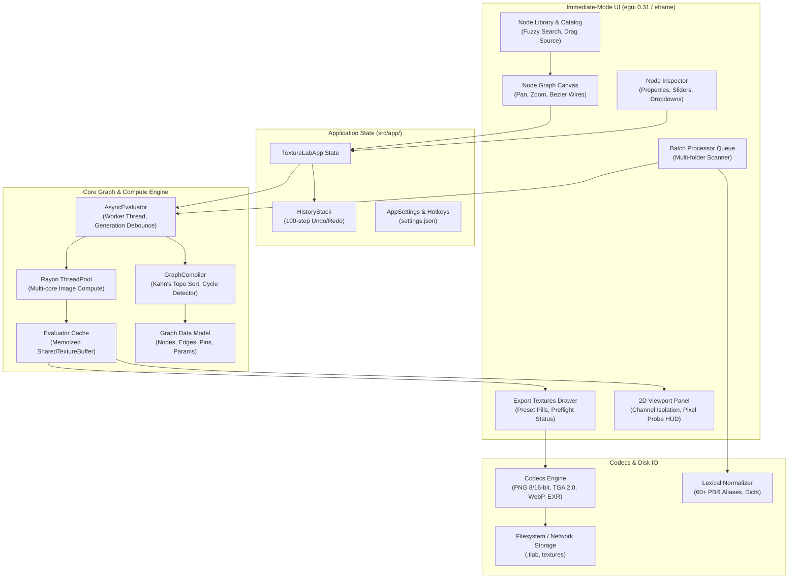
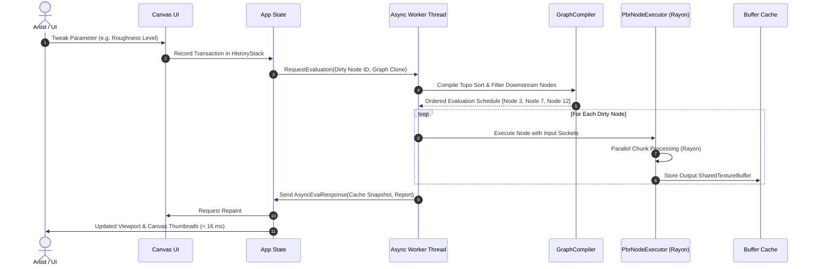
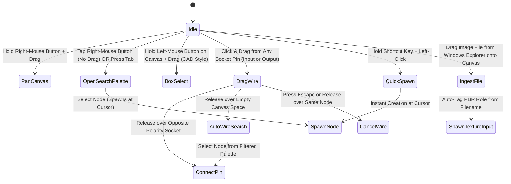
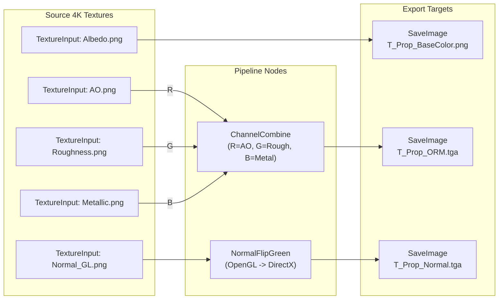
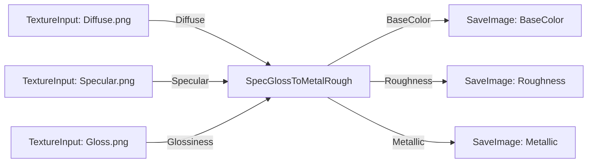
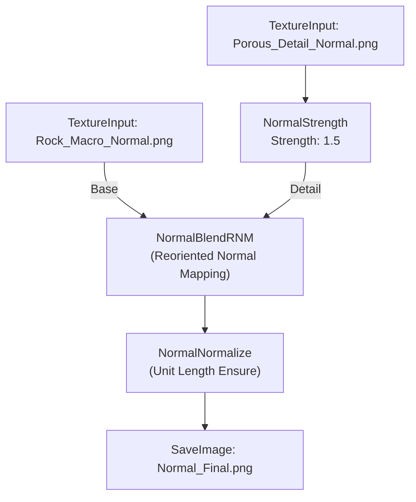

# ARKH TextureLAB — Master Technical Reference Manual

> **Product:** ARKH TextureLAB (v1.0.0)  
> **Classification:** PBR Texture Authoring & Channel Packing Workstation  
> **Target Audience:** Technical Artists, Environment Artists, Game Developers, Pipeline TDs, Graphics Engineers  
> **Format:** Obsidian Flavored Markdown (Callouts, Mermaid, Wikilinks, ASCII Diagrams)

---

## Table of Contents

- [1. Executive Summary & Core Philosophy](#1-executive-summary--core-philosophy)
- [2. System Architecture & Engineering Deep-Dive](#2-system-architecture--engineering-deep-dive)
- [3. Installation, Toolchain & Build Guide](#3-installation-toolchain--build-guide)
- [4. Workstation Interface & Docking Anatomy](#4-workstation-interface--docking-anatomy)
- [5. Canvas Navigation & Unreal-Standard Controls](#5-canvas-navigation--unreal-standard-controls)
- [6. Comprehensive PBR Node Catalog (21 Nodes)](#6-comprehensive-pbr-node-catalog-21-nodes)
- [7. Step-by-Step Production Tutorials](#7-step-by-step-production-tutorials)
  - [Tutorial 1: Packing a 4K Unreal Engine 5 ORM Texture](#tutorial-1-packing-a-4k-unreal-engine-5-orm-texture)
  - [Tutorial 2: Converting Specular/Glossiness to Metallic/Roughness](#tutorial-2-converting-specularglossiness-to-metallicroughness)
  - [Tutorial 3: Normal Map Normalization, Strength & RNM Blending](#tutorial-3-normal-map-normalization-strength--rnm-blending)
  - [Tutorial 4: Texture Set Validation & One-Click Resolution Auto-Fix](#tutorial-4-texture-set-validation--one-click-resolution-auto-fix)
  - [Tutorial 5: Designing Custom Channel Packing Presets](#tutorial-5-designing-custom-channel-packing-presets)
  - [Tutorial 6: Automated Multi-Folder Batch Processing](#tutorial-6-automated-multi-folder-batch-processing)
  - [Tutorial 7: Headless CI/CD Automation with `texturelab-cli`](#tutorial-7-headless-cicd-automation-with-texturelab-cli)
- [8. PBR Lexical Normalizer & Dictionary Engine](#8-pbr-lexical-normalizer--dictionary-engine)
- [9. Token System & Export Formatting](#9-token-system--export-formatting)
- [10. Image Codecs, Color Spaces & Bit Depths](#10-image-codecs-color-spaces--bit-depths)
- [11. Complete Hotkey & Hold-Key Quick-Spawn Matrix](#11-complete-hotkey--hold-key-quick-spawn-matrix)
- [12. Configuration, Presets & Persistence (`.tlab`)](#12-configuration-presets--persistence-tlab)
- [13. Developer Guide: Extending Nodes & Adding Codecs](#13-developer-guide-extending-nodes--adding-codecs)
- [14. Troubleshooting, Diagnostic Runbook & FAQ](#14-troubleshooting-diagnostic-runbook--faq)

---

## 1. Executive Summary & Core Philosophy

ARKH TextureLAB is a 100% pure Rust desktop workstation and headless CLI pipeline designed specifically for game developers, technical artists, and visual effects studios. It eliminates the friction of channel packing, format conversion, normal space alignment, and texture set validation.

```
┌──────────────────────────────────────────────────────────────────────────────┐
│                    ARKH TextureLAB — Architectural Stack                     │
├──────────────────────────────────────────────────────────────────────────────┤
│  Runtime       : Pure Native Rust (2021 Edition)                             │
│  UI Framework  : eframe 0.31 + egui 0.31 + egui_dock 0.16 (Immediate Mode)   │
│  Compute Engine: Rayon 1.10 Multi-Threaded Parallel Task Pool                │
│  Evaluation    : Directed Acyclic Graph (DAG) with Kahn's Topological Sort    │
│  Cache Engine  : Memoized Node Buffers + Thread-Safe LRU Image Disk Cache    │
│  Binary Footprint: ~6 MB Portable Windows PE Executable (Zero External DLLs) │
│  Startup Time  : < 100 ms Cold Boot Execution                                │
└──────────────────────────────────────────────────────────────────────────────┘
```

### 1.1 The Problems It Solves

1. **The Heavyweight DCC Tax**: Traditional texture authoring suites (Substance 3D Designer, Photoshop) require gigabytes of disk space, require commercial licensing servers, and take 15–45 seconds to launch just to pack an Ambient Occlusion, Roughness, and Metallic map into an ORM texture.
2. **Channel Swizzle Errors**: Manually copying and pasting color channels in image editors frequently leads to accidental color space corruptions (e.g. sRGB curves baked into linear roughness data) or inverted green normal channels.
3. **Pipeline Inconsistencies**: Teams mix Megascans, Poly Haven, Quixel, and internal asset naming conventions (`_rough`, `_r`, `_Roughness`, `_ROUGH`). TextureLAB's lexical normalizer standardizes 60+ aliases automatically.
4. **CI/CD Automation Gaps**: Artists create complex packing workflows that cannot be executed headlessly on automated build agents. TextureLAB provides a dedicated `texturelab-cli` binary that executes the exact same `.tlab` node graph in headless batch pipelines.

### 1.2 Performance & Design Invariants

- **Zero Runtime Dependencies**: No Python runtime, no MSVC redistributable runtime installer required, no node.js or electron overhead.
- **Topological Invalidation**: Changes to an upstream parameter invalidate only downstream dependent nodes; unaffected subgraphs retain their memoized execution cache.
- **Rayon Parallelism**: Multi-channel packing operations run across all available CPU cores using cache-friendly contiguous SIMD-friendly scanlines.
- **Empirical Rigor**: Fully verified with 240+ automated unit and integration tests covering every mathematical operation, cycle detection case, codec byte-level header, and hotkey chord.

---

## 2. System Architecture & Engineering Deep-Dive

TextureLAB is organized into a modular decoupling between graph data models, topological evaluation, parallel image processing, and immediate-mode UI rendering.

### 2.1 High-Level Component Diagram



### 2.2 Kahn's Topological Sort & Cycle Rejection

To ensure deterministic evaluation without infinite loops, `GraphCompiler` (`src/graph/compiler.rs`) compiles the active node network into a strictly linear execution schedule using **Kahn's Algorithm**:

1. Calculate in-degrees (number of incoming data edges) for all nodes in the graph.
2. Initialize a queue $Q$ with all nodes having an in-degree of 0 (e.g., `TextureInput`, `ConstantScalar`, `ConstantColor`).
3. While $Q$ is not empty:
   - Dequeue node $u$ and append it to the topological evaluation schedule.
   - For each outgoing edge $(u, v)$:
     - Decrement the in-degree of downstream node $v$.
     - If $v$'s in-degree drops to 0, enqueue $v$.
4. **Cycle Detection Gate**: If the count of nodes in the sorted schedule does not equal the total number of nodes in the graph, a cycle exists. The compiler rejects the evaluation, flags the offending cyclic edges, and emits an `EvaluationError::CycleDetected`.



### 2.3 Memory Management & Zero-Copy Architecture

- **`TextureBuffer` (`src/core/buffer.rs`)**: Internally wraps an `image::RgbaImage` with dimensions $(W, H)$ in contiguous 8-bit RGBA memory.
- **`SharedTextureBuffer`**: Defined as `Arc<TextureBuffer>`. Wire connections pass reference-counted smart pointers across node boundaries. If a downstream node only reads data (such as a split channel operation), it reads the buffer without allocating a full clone of the upstream texture.
- **LRU Disk Image Cache**: Source textures loaded from disk are cached via a thread-safe LRU structure keyed by absolute canonical path and file modification timestamp (`mtime`).

---

## 3. Installation, Toolchain & Build Guide

### 3.1 Prerequisites & Toolchain Verification

TextureLAB is built with pure standard Rust. No external C++ libraries or system-level SDKs are required.

- **Rust Version**: `1.80.0` or higher (tested on stable 2021 edition).
- **Cargo**: Included with official Rust toolchain (`rustup`).
- **Operating System**: Windows 10/11 (64-bit), Linux (Wayland / X11 via `glow`), macOS.

```powershell
# Verify Rust and Cargo installation
rustc --version
cargo --version
```

### 3.2 Automated Setup Scripts

The repository includes pre-built Windows batch scripts for one-click setup, test verification, and portable execution:

```powershell
# 1. Run Complete Setup, Verification & Release Build
.\setup.bat

# 2. Launch the Compiled Portable Workstation
.\run_desktop.bat
```

> [!NOTE]
> `setup.bat` executes a complete toolchain audit, validates all 240+ unit and integration tests, verifies clean Clippy reports (`cargo clippy -- -D warnings`), and compiles the optimized release binary to `target/release/texturelab.exe`.

### 3.3 Manual Cargo Compilation & Release Standard

In accordance with project workspace governance, **`target\release\` is the sole release folder**. Never create duplicate `release/` directories in the repository root.

```powershell
# Run Debug Development Workstation
cargo run

# Run Optimised Release Workstation
cargo run --release

# Run Full Test Suite (240+ Tests)
cargo test

# Strict Lint & Quality Gate (Zero Warnings Allowed)
cargo clippy -- -D warnings

# Build Standalone Portable Binary
cargo build --release
```

#### Compilation Artifacts

Upon release compilation, Cargo generates two standalone binaries in `target\release\`:
1. `texturelab.exe` (~6.2 MB) — The complete interactive GUI workstation.
2. `texturelab-cli.exe` (~4.8 MB) — The headless command-line pipeline runner.

> [!TIP]
> **Network Share Synchronization**: When running the release build script, TextureLAB attempts to silently synchronize `texturelab.exe` to the studio share `\\192.168.11.11\FastShare\Arman\Apps\TextureLab\texturelab.exe`. If the network share is unavailable, the script completes cleanly with exit code 0 without interrupting local development.

---

## 4. Workstation Interface & Docking Anatomy

TextureLAB features a high-density, WCAG AA compliant **Obsidian Graphite Blueprint** interface built on top of `egui_dock 0.16`. Every panel can be freely resized, tabbed, detached, or docked.

```
┌────────────────────────────────────────────────────────────────────────────────────────┐
│ [≡] File  Edit  View  Presets  Tools  Help                   TextureLAB by ARKH v1.0.0 │
├─────────────────┬──────────────────────────────────────────┬───────────────────────────┤
│ NODE LIBRARY    │ GRAPH CANVAS                             │ 2D VIEWPORT               │
│ [Search nodes]  │                                          │ ┌───────────────────────┐ │
│ ▾ I/O           │   ┌──────────────┐                       │ │                       │ │
│   Texture Input │   │ TextureInput │                       │ │                       │ │
│   Export Output │   │ [BaseColor]  │                       │ │     ACTIVE PREVIEW    │ │
│ ▾ CHANNEL OPS   │   └──────┬───────┘                       │ │       SELECTION       │ │
│   Combine (C)   │          │                               │ │                       │ │
│   Split (S)     │          ▼                               │ └───────────────────────┘ │
│   Mixer         │   ┌──────────────┐      ┌─────────────┐  │ [RGB][R][G][B][A] [1x][2x]│
│   Spec/Gloss    │   │ChannelCombine│ ───► │ SaveImage   │  │ UV: (0.45, 0.82) RGBA: 242│
│ ▾ COLOR ADJUST  │   │ R  G  B  A   │      │ [ORM_Map]   │  ├───────────────────────────┤
│   Invert (I)    │   └──────────────┘      └─────────────┘  │ PROPERTIES / INSPECTOR    │
│   Levels (L)    │                                          │ Node: ChannelCombine #4   │
│   Bright/Contr  │                                          │ ▾ Channel Routing         │
│ ▾ NORMAL OPS    │                                          │   R Source: AO.R          │
│   Flip Green (N)│                                          │   G Source: Roughness.G   │
│   Normalize     │                                          │   B Source: Metallic.B    │
│ ▾ BLEND & MATH  │                                          │   A Source: None (1.0)    │
├─────────────────┴──────────────────────────────────────────┴───────────────────────────┤
│ [Ready] 5 Nodes | 4 Edges | Evaluated in 3.4 ms | Canvas Zoom: 100% | Memory: 42 MB    │
└────────────────────────────────────────────────────────────────────────────────────────┘
```

### 4.1 Interface Panels Breakdown

| Panel Name | Default Dock Position | Purpose & Capabilities |
|---|---|---|
| **Node Library** | Left Sidebar | Categorized tree of all 21 node types with keyboard shortcut badges. Items can be dragged directly onto the canvas. Features compact 23px rows with subtle alternating banding. |
| **Graph Canvas** | Center Workspace | Infinite pan/zoom canvas displaying nodes, Bezier wire connections, comment grouping boxes, and minimap navigation. |
| **2D Viewport** | Upper Right | Live interactive preview of the selected or pinned node. Supports channel soloing (RGB, R, G, B, A), seamless UV tiling (1x, 2x, 4x), pixel probe HUD, and A/B split comparison. |
| **Inspector** | Lower Right | Contextual parameter editor for the selected node. Adjust scalar sliders, color pickers, file paths, POT rounding modes, and normal vectors. |
| **Export Textures** | Bottom Drawer / Tab (`Ctrl+E`) | Preflight summary card, preset selector pills, destination folder path, health badge, and export targets table. |
| **Batch Processor** | Modal Window / Tab | Multi-folder queue manager for automated texture set scanning, template application, and bulk exporting. |
| **Preset Designer** | Tab (`Presets → Preset Designer`) | Channel routing matrix editor for authoring custom multi-channel packing standards saved to `presets.json`. |
| **Status Bar** | Bottom Strip | Real-time telemetry: node count, edge count, last DAG evaluation time in milliseconds, zoom level, and memory usage. |

---

## 5. Canvas Navigation & Unreal-Standard Controls

TextureLAB adopts the **Unreal Engine Material Editor** interaction standards for camera control, wire routing, and node spawning.



### 5.1 Mouse Navigation Standards

- **Pan Canvas**: Hold **Right-Mouse Button** and drag anywhere on the canvas.
- **Zoom Canvas**: Scroll the **Mouse Wheel** (zooms centered at the cursor position, clamped between `0.1x` and `3.0x`).
- **Context Search Palette**: **Tap Right-Mouse Button** (without dragging) or press **`Tab`**. The search box spawns directly at the cursor coordinates. Pressing **`Escape`** or clicking outside dismisses it.
- **Sever Connection**: Hold **`Alt` + Left-Click** on any wire or socket pin.
- **Wire Reroute Insertion**: **Double-Click** directly on any Bezier wire to split the connection and insert an inline `Reroute` pin.
- **Multi-Node Selection (CAD Box Select)**: Click on empty canvas and drag a marquee selection rectangle. Nodes intersecting or fully inside the box are selected. Hold **`Shift`** to append to selection; hold **`Ctrl`** to toggle.
- **Duplicate Selected Nodes**: Press **`Ctrl + D`** (duplicates selected nodes with a `+30px, +30px` offset).
- **Clipboard Operations**: **`Ctrl + C`** copies selected nodes to system clipboard; **`Ctrl + V`** pastes nodes centered at current mouse position.
- **Auto-Layout Graph**: Press **`Ctrl + F`** to automatically arrange all nodes in clean, non-overlapping topological columns.

### 5.2 Two-Way Wire Drag & Drop and Auto-Wiring

TextureLAB supports bidirectional wire routing:
1. **Output $\to$ Input**: Drag from an output socket pin (e.g. `TextureInput.RGB`) and release on an input socket (e.g. `ChannelCombine.R`).
2. **Input $\to$ Output**: Drag backwards from an input socket and connect to an upstream output socket. Polarity validation prevents connecting output-to-output or input-to-input.
3. **Wire-Drop Auto-Wire**: Drag a wire from any socket and release it over **empty canvas space**. The fuzzy search palette opens automatically at the release coordinates. Selecting a node automatically creates it and connects the originating wire to the most compatible socket:
   - *Exact Socket Match*: `R` connects to `R`, `RGBA` connects to `RGBA`.
   - *Compatibility Match*: `RGB` connects to `RGBA`, `Scalar` connects to `Alpha`.
   - *First Compatible Socket*: Connects to the first available input or output pin.

---

## 6. Comprehensive PBR Node Catalog (21 Nodes)

TextureLAB includes 21 node types across 9 functional categories.

```
┌─────────────────────────────────────────────────────────────────────────────┐
│ Category Index:                                                             │
│ 1. I/O (Input/Output)       2. Constants          3. Channel Operations     │
│ 4. Color & Adjust           5. Normal Operations  6. Blend Operations       │
│ 7. Math Operations          8. Transform          9. Utility                │
└─────────────────────────────────────────────────────────────────────────────┘
```

### 6.1 I/O Category

#### 1. `TextureInput`
Loads an external bitmap from disk or provides a solid color fallback. Features lexical PBR role detection.
- **Inputs**: None.
- **Outputs**: `RGBA` (Full color buffer), `R` (Red scalar), `G` (Green scalar), `B` (Blue scalar), `A` (Alpha scalar).
- **Parameters**:
  - `Path`: String path to image file (`.png`, `.tga`, `.jpg`, `.webp`, `.bmp`, `.exr`).
  - `Fallback Color`: RGBA color value used when no file path is specified.
  - `Color Space`: `sRGB` (auto-linearized during math) or `Linear` (raw data preservation).
  - `PBR Role`: Auto-inferred role badge (`BaseColor`, `Normal`, `Roughness`, `Metallic`, `AO`, `Height`, `Emissive`, `Mask`).

#### 2. `SaveImage` (`TextureOutput`)
Specifies an export target for disk serialization or channel packing passes.
- **Inputs**: `RGBA` (Primary image input), `R`, `G`, `B`, `A` (Optional individual channel overrides).
- **Outputs**: None (Terminal sink node).
- **Parameters**:
  - `Slot Name`: Target PBR slot identifier (e.g. `ORM`, `BaseColor`, `NormalGL`, `MaskMap`).
  - `Format`: `PNG` (8-bit or 16-bit), `TGA` (2.0 uncompressed), `WebP`, `JPEG`, `BMP`, `EXR`.
  - `Bit Depth`: `8-bit` or `16-bit`.

---

### 6.2 Constants Category

#### 3. `ConstantScalar` (Hotkey: `1 + Click`)
Generates a uniform single-channel scalar value $[0.0, 1.0]$.
- **Inputs**: None.
- **Outputs**: `Value` (Scalar buffer), `R`, `G`, `B`, `A`.
- **Parameters**: `Value` (Float slider `0.00` to `1.00`, step `0.01`).
- **Use Case**: Providing default Roughness ($0.5$), Metallic ($0.0$), or Ambient Occlusion ($1.0$) values.

#### 4. `ConstantColor` (Hotkey: `3 + Click`)
Generates a uniform 4-channel solid color.
- **Inputs**: None.
- **Outputs**: `RGBA` (Color buffer), `R`, `G`, `B`, `A`.
- **Parameters**: `Color` (RGBA picker with Hex input and alpha slider).
- **Use Case**: Default BaseColor tinting, normal neutral fill `(128, 128, 255)`, or flat emission.

---

### 6.3 Channel Operations Category

#### 5. `ChannelCombine` (Hotkey: `C` or `P + Click`)
Packs up to four independent scalar or color inputs into a single combined 4-channel RGBA texture.
- **Inputs**: `R` (Red channel), `G` (Green channel), `B` (Blue channel), `A` (Alpha channel).
- **Outputs**: `RGBA` (Packed texture buffer).
- **Parameters**: Default fallback constants for unconnected pins (Default: `R=0`, `G=0`, `B=0`, `A=255`).
- **Use Case**: Unreal Engine ORM packing ($R=\text{AO}$, $G=\text{Roughness}$, $B=\text{Metallic}$).

#### 6. `ChannelSplit` (Hotkey: `S + Click`)
Unpacks a composite RGBA texture into four discrete grayscale scalar buffers.
- **Inputs**: `RGBA` (Composite image buffer).
- **Outputs**: `R` (Red as grayscale), `G` (Green as grayscale), `B` (Blue as grayscale), `A` (Alpha as grayscale).
- **Use Case**: Isolating individual channels from existing packed masks or extracting glossiness from alpha channels.

#### 7. `ChannelMixer` (Swizzle)
A 4x4 matrix swizzler allowing arbitrary channel reassignment and mathematical inversion per row.
- **Inputs**: `RGBA` (Source composite).
- **Outputs**: `RGBA` (Re-mapped composite).
- **Parameters**: 4 dropdown rows mapping output channels ($R_{out}, G_{out}, B_{out}, A_{out}$) to any source channel ($R, G, B, A, 0.0, 1.0$) with optional negate checkboxes.

#### 8. `SpecGlossToMetalRough`
Converts legacy Specular / Glossiness workflows into modern PBR Metallic / Roughness workflows.
- **Inputs**: `Diffuse` (RGB), `Specular` (RGB), `Glossiness` (Scalar).
- **Outputs**: `BaseColor` (RGB), `Metallic` (Grayscale), `Roughness` (Grayscale).
- **Conversion Equations**:
  $$\text{Roughness} = 1.0 - \text{Glossiness}$$
  $$\text{Metallic} = \text{max}(0.0, \frac{\text{Luminance}(\text{Specular}) - 0.04}{0.96})$$
  $$\text{BaseColor} = \begin{cases} \text{Diffuse} & \text{if } \text{Metallic} < 0.2 \\ \text{Specular} & \text{if } \text{Metallic} \ge 0.8 \\ \text{lerp}(\text{Diffuse}, \text{Specular}, \text{Metallic}) & \text{otherwise} \end{cases}$$

---

### 6.4 Color & Adjust Category

#### 9. `Invert` (Hotkey: `I + Click`)
Calculates the numerical complement of the input buffer: $O(x, y) = 1.0 - I(x, y)$.
- **Inputs**: `Input` (RGB or Scalar).
- **Outputs**: `Output` (Inverted buffer).
- **Parameters**: Per-channel toggles (`Invert R`, `Invert G`, `Invert B`, `Invert A`).
- **Use Case**: Converting Glossiness to Roughness, or inverting height/cavity masks.

#### 10. `Levels` (Hotkey: `L + Click`)
Full histogram remapping featuring input black/white points, output black/white scaling, and midtone gamma.
- **Inputs**: `Input` (RGB or Scalar).
- **Outputs**: `Output` (Adjusted buffer).
- **Parameters**: `Input Min` ($0.0–1.0$), `Input Max` ($0.0–1.0$), `Gamma` ($0.1–5.0$), `Output Min` ($0.0–1.0$), `Output Max` ($0.0–1.0$).
- **Formula**:
  $$I_{clamped} = \text{clamp}\left(\frac{I - \text{InMin}}{\text{InMax} - \text{InMin}}, 0.0, 1.0\right)$$
  $$O = \text{OutMin} + (\text{OutMax} - \text{OutMin}) \times (I_{clamped})^{1 / \text{Gamma}}$$

#### 11. `BrightnessContrast`
Standard contrast boost and brightness offset.
- **Inputs**: `Input` (RGB or Scalar).
- **Outputs**: `Output` (Adjusted buffer).
- **Parameters**: `Brightness` ($-1.0$ to $+1.0$, default $0.0$), `Contrast` ($-1.0$ to $+1.0$, default $0.0$).

---

### 6.5 Normal Operations Category

#### 12. `NormalFlipGreen` (Hotkey: `N + Click`)
Flips the normal map green channel ($Y$) to toggle between DirectX ($-Y$) and OpenGL ($+Y$) spaces.
- **Inputs**: `Normal` (Tangent space normal map).
- **Outputs**: `Normal` (Flipped normal map).
- **Formula**: $G_{out} = 255 - G_{in}$. (Red $X$ and Blue $Z$ channels remain unaltered).

#### 13. `NormalNormalize`
Re-normalizes every pixel's normal vector to unit length ($\|\vec{N}\| = 1.0$).
- **Inputs**: `Normal` (Normal map buffer).
- **Outputs**: `Normal` (Unit-length normal map).
- **Equation**:
  $$\vec{V} = \left(\frac{2R}{255} - 1, \frac{2G}{255} - 1, \frac{2B}{255} - 1\right), \quad \hat{N} = \frac{\vec{V}}{\sqrt{V_x^2 + V_y^2 + V_z^2}}$$
  $$R_{out} = \frac{\hat{N}_x + 1}{2} \times 255, \quad G_{out} = \frac{\hat{N}_y + 1}{2} \times 255, \quad B_{out} = \frac{\hat{N}_z + 1}{2} \times 255$$

#### 14. `NormalStrength`
Scales the perceived surface bump depth by scaling tangent vectors $X$ and $Y$ while preserving $Z$.
- **Inputs**: `Normal` (Normal map buffer).
- **Outputs**: `Normal` (Scaled normal map).
- **Parameters**: `Strength` (Float slider `0.0` to `5.0`, default `1.0`).

---

### 6.6 Blend Operations Category

#### 15. `LayerBlend` (Hotkey: `B + Click`)
Blends a foreground layer over a background layer using an optional grayscale alpha mask.
- **Inputs**: `Base` (Background RGBA), `Layer` (Foreground RGBA), `Mask` (Optional grayscale scalar).
- **Outputs**: `Output` (Blended RGBA).
- **Parameters**:
  - `Blend Mode`: `Normal` (Lerp), `Add`, `Subtract`, `Multiply`, `Screen`, `Overlay`.
  - `Opacity`: Global blend factor $[0.0, 1.0]$.

#### 16. `NormalBlendRNM`
Blends two tangent-space normal maps using **Reoriented Normal Mapping (RNM)** by Stephen Hill & Colin Barré-Brisebois. Unlike linear blending, RNM does not flatten high-frequency micro-details or reduce vector magnitude.
- **Inputs**: `Base` (Base surface normal map), `Detail` (High-frequency detail normal map).
- **Outputs**: `Normal` (Reoriented composite normal map).
- **RNM Mathematical Formulation**:
  $$\vec{n}_1 = \text{Unpack}(Base) = (x_1, y_1, z_1), \quad \vec{n}_2 = \text{Unpack}(Detail) = (x_2, y_2, z_2)$$
  $$\vec{u} = (x_1, y_1, z_1 + 1), \quad \vec{v} = (-x_2, -y_2, z_2)$$
  $$\vec{n}_{\text{rnm}} = \vec{u} \times \frac{\vec{u} \cdot \vec{v}}{z_1 + 1} - \vec{v}$$
  $$\vec{N}_{\text{final}} = \text{Normalize}(\vec{n}_{\text{rnm}})$$

---

### 6.7 Math Operations Category

#### 17. `Math` (Hotkey: `M + Click`)
High-performance arithmetic engine providing 13 scalar and vector operations.
- **Inputs**: `A` (Primary buffer), `B` (Secondary buffer or constant).
- **Outputs**: `Output` (Computed buffer).
- **Available Operations**:
  1. `Add`: $A + B$
  2. `Subtract`: $A - B$
  3. `Multiply`: $A \times B$
  4. `Divide`: $A / B$ (guarded against division by zero)
  5. `Power`: $A^B$
  6. `Min`: $\min(A, B)$
  7. `Max`: $\max(A, B)$
  8. `Clamp`: $\text{clamp}(A, \text{Min}, \text{Max})$
  9. `Abs`: $|A|$
  10. `Step`: $\begin{cases} 1.0 & \text{if } A \ge B \\ 0.0 & \text{otherwise} \end{cases}$
  11. `Smoothstep`: Hermite interpolation between edges
  12. `Modulo`: $A \pmod B$
  13. `Average`: $(A + B) / 2$

---

### 6.8 Transform Category

#### 18. `Resize`
Scales image buffers with Power-of-Two (POT) dimension rounding or custom pixel targets.
- **Inputs**: `Input` (Image buffer).
- **Outputs**: `Output` (Resampled buffer).
- **Parameters**:
  - `Mode`: `PowerOfTwo` (Nearest, Next, or Previous POT) or `Explicit` ($W \times H$).
  - `Filter`: `Bilinear` (smooth interpolation) or `Nearest` (pixelated/data preservation for index masks).

---

### 6.9 Utility Category

#### 19. `Comment` (Hotkey: `/` or Double-Click Canvas)
A resizable visual grouping box for documenting subgraphs and organizing complex networks.
- **Inputs/Outputs**: None (Non-evaluating visual container).
- **Parameters**: `Title` (Label string), `Color` (Background tint), `Dimensions` ($W \times H$).

#### 20. `Reroute` (Double-Click on Wire)
A zero-overhead passthrough socket dot for routing wires cleanly around large node clusters.
- **Inputs**: `Input` (Any type).
- **Outputs**: `Output` (Identical passthrough).

---

## 7. Step-by-Step Production Tutorials

---

### Tutorial 1: Packing a 4K Unreal Engine 5 ORM Texture

**Goal**: Convert loose Megascans textures (`Albedo.png`, `Normal_GL.png`, `Roughness.png`, `Metallic.png`, `AO.png`) into Epic Games standard **BaseColor**, **Normal (DirectX)**, and packed **ORM** maps.



#### Step 1: Initialize Project & Import Textures
1. Launch TextureLAB.
2. Open Windows Explorer alongside TextureLAB.
3. Select your 5 texture files (`Albedo.png`, `Normal_GL.png`, `Roughness.png`, `Metallic.png`, `AO.png`) and **drag them directly onto the canvas**.
4. TextureLAB automatically instantiates 5 `TextureInput` nodes and assigns lexical PBR role badges based on their filenames.

#### Step 2: Spawn Channel Combiner
1. Hold **`C`** or **`P`** and **Left-Click** on the canvas to the right of your input nodes.
2. A `ChannelCombine` node appears at your cursor.

#### Step 3: Wire the ORM Channels
1. Click and drag a wire from the **`R` socket** of the `AO` node to the **`R` input** of `ChannelCombine`.
2. Drag from the **`G` socket** of the `Roughness` node to the **`G` input** of `ChannelCombine`.
3. Drag from the **`B` socket** of the `Metallic` node to the **`B` input** of `ChannelCombine`.
4. Leave the **`A` input** unconnected (defaults to solid white $1.0$).

#### Step 4: Fix Normal Space for Unreal Engine
1. Unreal Engine requires **DirectX** normal maps ($-Y$). Because the source texture is OpenGL ($+Y$), spawn a `NormalFlipGreen` node by holding **`N`** and clicking the canvas.
2. Drag a wire from `Normal_GL` output `RGBA` to `NormalFlipGreen` input.

#### Step 5: Configure Export Targets
1. Drag from `ChannelCombine` output `RGBA` into empty canvas space and release. The search palette opens; type `SaveImage` and press Enter.
2. In the Inspector panel for this new `SaveImage` node:
   - Set **Slot Name** to `ORM`.
   - Set **Format** to `TGA` (or `PNG`).
3. Repeat for `BaseColor` (linked directly from the Albedo node) and `Normal` (linked from `NormalFlipGreen`).

#### Step 6: Execute Export
1. Press **`Ctrl + E`** to open the **Export Textures** drawer.
2. Select the **Unreal Engine 5** preset pill (`T_{asset}_{slot}`).
3. Verify that the preflight badge shows **All Checks Passed (Ready)**.
4. Click **"Export Textures to Disk"**. All maps are packed and written concurrently in under 150 ms.

---

### Tutorial 2: Converting Specular/Glossiness to Metallic/Roughness

**Goal**: Re-author a legacy asset textured in Diffuse/Specular/Glossiness into a modern glTF / Blender / UE5 Metallic-Roughness set.



1. Drag `Diffuse.png`, `Specular.png`, and `Gloss.png` onto the canvas.
2. Press **`Tab`**, type `SpecGloss`, and hit **`Enter`** to spawn the `SpecGlossToMetalRough` node.
3. Connect:
   - `Diffuse.RGBA` $\to$ `SpecGlossToMetalRough.Diffuse`
   - `Specular.RGBA` $\to$ `SpecGlossToMetalRough.Specular`
   - `Gloss.R` (or `A` if packed in alpha) $\to$ `SpecGlossToMetalRough.Glossiness`
4. The node automatically calculates:
   - Inverted roughness: $\text{Roughness} = 1.0 - \text{Glossiness}$.
   - Linear metallic mask separating dielectrics (F0 ~ 0.04) from conductive raw metals.
   - Energy-conserving BaseColor map.
5. Connect the outputs (`BaseColor`, `Roughness`, `Metallic`) to respective `SaveImage` nodes or feed them into a `ChannelCombine` node.

---

### Tutorial 3: Normal Map Normalization, Strength & RNM Blending

**Goal**: Blend a macro rock face normal map with a micro porous detail normal map without losing tangent curvature.



1. Spawn two `TextureInput` nodes for `Rock_Macro_Normal` and `Porous_Detail_Normal`.
2. Spawn a `NormalStrength` node. Connect the detail normal map and set the `Strength` parameter to `1.5` in the Inspector to amplify porous cracks.
3. Press **`Tab`** and spawn `NormalBlendRNM`.
4. Connect:
   - `Rock_Macro_Normal` $\to$ `Base` socket.
   - `NormalStrength` $\to$ `Detail` socket.
5. To guarantee GPU mipmap compliance and prevent lighting distortions, connect the output to `NormalNormalize`.
6. Inspect the result in the 2D Viewport: toggle the **Blue channel (`B`)** to verify high-frequency fidelity without flattening.

---

### Tutorial 4: Texture Set Validation & One-Click Resolution Auto-Fix

**Goal**: Inspect an asset package containing mixed resolutions (e.g., 4K Albedo, 2K Normal, 1K AO) and non-power-of-two (non-POT) textures before exporting to engine.

```
┌─────────────────────────────────────────────────────────────────────────────┐
│ TEXTURE SET VALIDATOR PREFLIGHT REPORT                                      │
├─────────────────────────────────────────────────────────────────────────────┤
│ Status: ⚠️ 2 Issues Detected                                                │
│                                                                             │
│ [!] Resolution Mismatch Detected:                                           │
│     • Albedo:  4096 × 4096 (POT Target Master)                             │
│     • AO:      1024 × 1024 [Mismatch]                                       │
│     • Normal:  2048 × 2048 [Mismatch]                                       │
│                                                                             │
│ [!] Non-Power-of-Two (Non-POT) Detected:                                    │
│     • Mask_Decal: 1920 × 1080 (Causes GPU Mipmap Streaming Failure)         │
│                                                                             │
│ ACTION:                                                                     │
│ ┌─────────────────────────────────────────────────────────────────────────┐ │
│ │ [⚡ Auto-Fix: Insert Resize Nodes to 4096×4096 (Lanczos3)]               │ │
│ └─────────────────────────────────────────────────────────────────────────┘ │
└─────────────────────────────────────────────────────────────────────────────┘
```

1. With your graph open, click **`Tools → Validate Texture Set`** (or open the Validator tab).
2. The validator scans all `TextureInput` and `SaveImage` nodes against 4 strict quality gates:
   - **Completeness**: Ensures no missing core maps for the active preset.
   - **Uniformity**: Verifies all nodes evaluate to the same resolution.
   - **POT Compliance**: Flags irregular dimensions like $1920 \times 1080$ or $1000 \times 1000$.
   - **Naming Health**: Validates file stems against PBR naming dictionaries.
3. If resolutions differ, click the prominent **"Auto-Fix All Resolution Mismatches"** button.
4. TextureLAB automatically inserts `Resize` nodes between the mismatched inputs and downstream nodes, setting them to match the dominant master resolution (4096×4096) with high-quality Bilinear/Lanczos3 filtering.
5. The preflight badge turns **Green: "All checks passed — Ready for production export"**.

---

### Tutorial 5: Designing Custom Channel Packing Presets

**Goal**: Create a custom packing profile for a custom proprietary shader requiring:
- Map 1 (`_Surface`): Red = Metalness, Green = Curvature, Blue = Thickness, Alpha = Roughness.
- Map 2 (`_Normal`): 16-bit PNG.

```
┌─────────────────────────────────────────────────────────────────────────────┐
│ CUSTOM PRESET DESIGNER: "StudioProprietary_v2"                              │
├─────────────────────────────────────────────────────────────────────────────┤
│ Preset ID: `studio_prop`   Naming Pattern: `{asset}_{slot}`                 │
├─────────────────────────────────────────────────────────────────────────────┤
│ SLOTS CONFIGURATION:                                                        │
│                                                                             │
│ Slot 1: "Surface" | Format: PNG (8-bit) | Pattern: `{asset}_Surface`       │
│ ┌─────────┬──────────────────────┬─────────┬──────────────────────────────┐ │
│ │ Channel │ Source Node Slot     │ Channel │ Status                       │ │
│ ├─────────┼──────────────────────┼─────────┼──────────────────────────────┤ │
│ │ Red     │ Metallic             │ R       │ Active                       │ │
│ │ Green   │ Curvature            │ R       │ Active                       │ │
│ │ Blue    │ Thickness            │ R       │ Active                       │ │
│ │ Alpha   │ Roughness            │ R       │ Active                       │ │
│ └─────────┴──────────────────────┴─────────┴──────────────────────────────┘ │
│                                                                             │
│ Slot 2: "Normal" | Format: PNG (16-bit) | Pattern: `{asset}_Normal`        │
│ ┌─────────┬──────────────────────┬─────────┬──────────────────────────────┐ │
│ │ RGB     │ NormalNormalize      │ RGB     │ Active                       │ │
│ └─────────┴──────────────────────┴─────────┴──────────────────────────────┘ │
│                                                                             │
│ [Save Preset to presets.json]                                               │
└─────────────────────────────────────────────────────────────────────────────┘
```

1. Navigate to **`Presets → Preset Designer`**.
2. Click **"New Custom Preset"**.
3. Name the preset `StudioProprietary` and set ID to `studio_prop`.
4. Click **"Add Slot"** and name it `Surface`. Set format to `PNG`.
5. In the Channel Routing Matrix:
   - For **Red**, select source map `Metallic` and channel `R`.
   - For **Green**, select source map `Curvature` and channel `R`.
   - For **Blue**, select source map `Thickness` and channel `R`.
   - For **Alpha**, select source map `Roughness` and channel `R`.
6. Click **"Add Slot"** for `Normal`. Set format to `PNG` and bit depth to `16-bit`.
7. Click **"Save Preset"**. The specification is saved to your user settings directory (`presets.json`) and immediately becomes selectable in the Export drawer and CLI runner.

---

### Tutorial 6: Automated Multi-Folder Batch Processing

**Goal**: Process an entire directory containing 50 subfolders of asset textures (e.g. `Rock_01/`, `Wood_02/`, `Metal_03/`) without opening each graph manually.

1. Select **`Tools → Batch Processor`** from the main menu.
2. Click **"Scan Input Directory"** and choose your root textures directory (e.g. `D:\Assets\RawTextures\`).
3. TextureLAB scans all subdirectories, identifies texture sets by asset stem, and automatically matches them against the lexical PBR dictionary.
4. Choose an export preset (e.g. **Unreal Engine 5** or your custom preset).
5. Specify an output folder (or leave blank to create an `exports/` folder inside each asset directory).
6. Click **"Process Queue"**:
   - The engine parallelizes evaluation across CPU cores.
   - A progress bar updates in real time with throughput metrics (e.g. `12 sets / sec`, `3.2 GB processed`).
   - Any problematic sets (e.g. missing normal maps) are flagged in the completion report table with descriptive warnings.

---

### Tutorial 7: Headless CI/CD Automation with `texturelab-cli`

**Goal**: Run texture packing headlessly on GitHub Actions, Jenkins, or per-commit Git hooks using `texturelab-cli.exe`.

#### CLI Syntax & Argument Reference

```powershell
texturelab-cli [OPTIONS] --graph <GRAPH_FILE_OR_TEMPLATE> --input <DIR>
```

| Flag | Parameter | Description |
|---|---|---|
| `-g`, `--graph` | `<PATH>` | Path to a `.tlab` graph file or name of a built-in template (`"Pack Texture"`, `"Unpack Texture"`). |
| `-i`, `--input` | `<DIR>` | Directory containing source texture maps to process. |
| `-o`, `--output` | `<DIR>` | Destination directory for exported textures (defaults to `<input>/exports`). |
| `-p`, `--preset` | `<ID>` | Export preset identifier (`ue5`, `unity`, `substance`, `blender`, `cryengine`, or custom ID). |
| `-r`, `--resolution` | `WIDTHxHEIGHT` | Working resolution override (e.g. `2048x2048`, `4096x4096`). |
| `-f`, `--format` | `<FMT>` | Output format override (`PNG`, `TGA`, `EXR`, `JPG`, `WEBP`, `BMP`). |
| `-q`, `--quiet` | Flag | Suppress progress messages; output only fatal errors. |
| `-v`, `--verbose` | Flag | Output full execution timeline, DAG schedule, and node execution times. |
| `-h`, `--help` | Flag | Print CLI help documentation. |

#### Example 1: Headless ORM Pack from Built-in Template

```powershell
# Pack textures in 'Char_Knight' using built-in template and UE5 preset
texturelab-cli.exe --graph "Pack Texture" --input "C:\Assets\Char_Knight" --preset ue5 --output "C:\Assets\Char_Knight\Packed"
```

#### Example 2: Headless Custom Project Execution with 2K Resize

```powershell
# Execute custom project graph, overriding resolution to 2048x2048
texturelab-cli.exe --graph "D:\Pipelines\HeroAssetPacker.tlab" --input "D:\Builds\Weapons\Sword" --resolution 2048x2048 --format TGA --verbose
```

#### Example 3: CI/CD Pipeline Script (GitHub Actions Workflow)

```yaml
name: Texture Asset Packaging Pipeline

on:
  push:
    paths:
      - 'assets/textures/**'

jobs:
  pack-textures:
    runs-on: windows-latest
    steps:
      - name: Checkout Repository
        uses: actions/checkout@v4

      - name: Run TextureLAB Headless Exporter
        run: |
          .\target\release\texturelab-cli.exe `
            --graph "Pack Texture" `
            --input "./assets/textures/raw" `
            --output "./assets/textures/engine_ready" `
            --preset ue5 `
            --quiet
```

---

## 8. PBR Lexical Normalizer & Dictionary Engine

TextureLAB includes a dictionary of over 60+ industry naming conventions and abbreviations (`src/normalizer/dicts.rs`), enabling automatic classification of imported files regardless of authoring software.

### 8.1 Suffix & Keyword Classification Table

| PBR Channel Role | Recognized Lexical Aliases & Tokens |
|---|---|
| **Base Color / Albedo** | `basecolor`, `base_color`, `basecol`, `albedo`, `diffuse`, `diff`, `color`, `col`, `alb`, `bc`, `d` |
| **Normal (DirectX / OpenGL)** | `normal`, `norm`, `nor`, `nrm`, `n`, `ddna`, `normalgl`, `normaldx`, `nor_gl`, `nor_dx`, `n_gl`, `n_dx` |
| **Roughness** | `roughness`, `rough`, `rgh`, `r`, `surface_roughness` |
| **Glossiness** | `glossiness`, `gloss`, `gls`, `g`, `smoothness`, `smooth` |
| **Metallic** | `metallic`, `metalness`, `metal`, `met`, `m`, `mtl` |
| **Ambient Occlusion** | `ambient_occlusion`, `ambientocclusion`, `ao`, `occ`, `occlusion`, `cavity` |
| **Height / Displacement** | `height`, `displacement`, `disp`, `bump`, `depth`, `h`, `d` |
| **Specular** | `specular`, `spec`, `spc`, `refl`, `reflectance` |
| **Opacity / Alpha** | `opacity`, `alpha`, `mask`, `transparent`, `transparency`, `cutout`, `op` |
| **Emissive** | `emissive`, `emission`, `emit`, `glow`, `illum`, `light` |

### 8.2 DirectX vs OpenGL Automatic Detection

The normalizer inspects filenames for explicit API cues:
- **DirectX ($-Y$)**: Matches `*dx*`, `*directx*`, `*n_dx*`, `*normal_dx*`.
- **OpenGL ($+Y$)**: Matches `*gl*`, `*opengl*`, `*n_gl*`, `*normal_gl*`.
- If an OpenGL normal map is loaded into a pipeline targeting DirectX (such as Unreal Engine), TextureLAB flags the mismatch and suggests inserting a `NormalFlipGreen` node.

### 8.3 Vendor Prefix Stripping

Common vendor prefixes are cleanly parsed to extract the canonical asset stem:
- `T_Chair_BaseColor.png` $\to$ Asset Stem: `Chair`
- `SM_Door_01_Normal.tga` $\to$ Asset Stem: `Door_01`
- `tex_wall_brick_ao.jpg` $\to$ Asset Stem: `wall_brick`
- Stripped prefixes: `T_`, `SM_`, `MI_`, `tex_`, `m_`, `mat_`, `diffuse_`, `albedo_`.

---

## 9. Token System & Export Formatting

TextureLAB supports tokenized path templates for naming export targets dynamically (`src/export/tokens.rs`).

### 9.1 Token Reference Table

| Token Variable | Description | Example Resolution |
|---|---|---|
| `{asset}` | Inferred asset stem from source textures or project name | `SciFiHelmet` |
| `{slot}` | Name of the export map slot | `BaseColor`, `ORM`, `Normal` |
| `{resolution}` | Pixel dimensions formatted as `WIDTHxHEIGHT` | `4096x4096`, `2048x2048` |
| `{res}` | Simplified resolution suffix (1K, 2K, 4K, 8K) | `4K`, `2K` |
| `{width}` | Explicit horizontal pixel count | `4096` |
| `{height}` | Explicit vertical pixel count | `4096` |
| `{ext}` | Lowercase file extension (without leading period) | `png`, `tga`, `exr` |
| `{format}` | Uppercase format name | `PNG`, `TGA` |
| `{project}` | Active project filename without extension | `Helmet_V1` |
| `{date}` | Current system date in ISO 8601 format (`YYYYMMDD`) | `20261015` |
| `{time}` | Current system time in 24-hour format (`HHMMSS`) | `173000` |
| `{udim}` | Tile coordinate placeholder for multi-tile UVs | `1001` |

### 9.2 Built-In Engine Preset Patterns

- **Unreal Engine 5**: `T_{asset}_{slot}` $\to$ `T_SciFiHelmet_ORM.tga`
- **Unity URP / HDRP**: `{asset}_{slot}` $\to$ `SciFiHelmet_MaskMap.png`
- **Substance 3D**: `{asset}_{slot}_{res}` $\to$ `SciFiHelmet_Roughness_4K.png`
- **Blender Principled**: `{asset}_{slot}` $\to$ `SciFiHelmet_BaseColor.png`
- **CryEngine**: `T_{asset}_{slot}` $\to$ `T_SciFiHelmet_ddna.tga`

---

## 10. Image Codecs, Color Spaces & Bit Depths

TextureLAB provides pure Rust image codecs with zero external DLL linkage.

### 10.1 Supported Codec Matrix

| Codec | Bit Depths | Compression / Characteristics | Ideal Use Case |
|---|---|---|---|
| **PNG** | 8-bit, 16-bit | Deflate lossless compression. Full alpha support. | BaseColor, Height maps, 16-bit displacement. |
| **TGA** | 8-bit | Uncompressed Truevision TGA 2.0 with custom 26-byte `TRUEVISION-XFILE.` footer. | Unreal Engine ORM, CryEngine, game source assets. |
| **OpenEXR** | 16-bit Half, 32-bit Float | High dynamic range floating point raster data. | Linear lighting passes, HDR environments. |
| **WebP** | 8-bit | Lossless or lossy web compression. Smallest file size. | Lightweight web preview, mobile asset bundles. |
| **JPEG** | 8-bit | Lossy discrete cosine transform. No alpha channel. | Fast previews, non-critical diffuse reference. |
| **BMP** | 8-bit | Uncompressed legacy raster bitmap. | Legacy game engines. |

### 10.2 Truevision TGA 2.0 Compliance

TextureLAB implements a byte-level TGA 2.0 encoder (`src/export/tga.rs`). It correctly appends the standardized 26-byte TGA 2.0 footer:

```
[4 bytes: Extension Area Offset]
[4 bytes: Developer Directory Offset]
[16 bytes: "TRUEVISION-XFILE."]
[1 byte:  ASCII '.' (Period)]
[1 byte:  Binary 0x00 (Null terminator)]
```

This ensures assets load without errors or warnings in Autodesk 3ds Max, Maya, Unreal Engine 5, and legacy game tools.

### 10.3 Color Space Invariants: sRGB vs Linear

- **Color Data (sRGB)**: `BaseColor`, `Albedo`, `Diffuse`, `Emissive`. These textures must be viewed with an sRGB gamma curve applied.
- **Data Masks (Linear)**: `Roughness`, `Metallic`, `Ambient Occlusion`, `Normal`, `Height`, `Mask`. These textures represent raw mathematical quantities ($0.0–1.0$). TextureLAB preserves raw scalar byte values without applying gamma conversions.

---

## 11. Complete Hotkey & Hold-Key Quick-Spawn Matrix

Hotkeys are defined in [`src/hotkeys/mod.rs`](file:///g:/AI/_ARKH_LAB/arkh_TextureLab/src/hotkeys/mod.rs).

### 11.1 Canvas Navigation & Spawning Shortcuts

| Shortcut Key | Action Performed |
|---|---|
| **`Tab`** | Open context fuzzy search & spawn palette at cursor position |
| **Right-Click Tap** | Open context fuzzy search & spawn palette at cursor position |
| **Right-Click Drag** | Infinite canvas panning |
| **Mouse Wheel** | Zoom canvas in / out (centered on cursor) |
| **`F`** | Frame camera on selected nodes (or frame all nodes if none selected) |
| **`Alt + Click`** | Sever wire or disconnect pin |
| **Wire Double-Click** | Insert inline `Reroute` node on wire |
| **`/`** or **Double-Click Canvas** | Spawn `Comment` grouping box at cursor |
| **`Ctrl + F`** | Auto-layout graph nodes into compact non-overlapping columns |

### 11.2 Hold-Key + Left-Click Quick Spawn Chords

Inspired by Unreal Engine Material Editor conventions, hold down a key and **Left-Click** on the canvas to spawn a node instantly:

| Hold-Key Chord | Spawned Node Type |
|---|---|
| **`1 + Click`** | `ConstantScalar` (1-channel float constant) |
| **`3 + Click`** | `ConstantColor` (4-channel RGB/RGBA constant) |
| **`M + Click`** | `Math` (Multiply / Arithmetic node) |
| **`B + Click`** | `LayerBlend` (Layer blend with mask) |
| **`S + Click`** | `ChannelSplit` (Channel unpacker) |
| **`C + Click`** or **`P + Click`** | `ChannelCombine` (Channel packer) |
| **`N + Click`** | `NormalFlipGreen` (DirectX $\leftrightarrow$ OpenGL normal flip) |
| **`L + Click`** | `Levels` (Histogram adjust node) |
| **`I + Click`** | `Invert` (Invert buffer node) |
| **`/ + Click`** | `Comment` (Comment grouping box) |

### 11.3 Transactional & Editing Shortcuts

| Shortcut Key | Action Performed | Focus Guard |
|---|---|---|
| **`Delete`** | Delete selected nodes or edges | Suppressed when typing in text fields |
| **`Ctrl + Z`** | Undo last graph transaction (100-step ring buffer) | Always available |
| **`Ctrl + Y`** / **`Ctrl + Shift + Z`** | Redo previously undone transaction | Always available |
| **`Ctrl + A`** | Select all nodes in graph | Canvas focus |
| **`Ctrl + C`** | Copy selected nodes to clipboard | Canvas focus |
| **`Ctrl + V`** | Paste clipboard nodes at cursor | Canvas focus |
| **`Ctrl + D`** | Duplicate selected nodes (+30px, +30px offset) | Canvas focus |
| **`Ctrl + S`** | Save current project (`.tlab`) | Always available |
| **`Ctrl + E`** | Toggle Export Textures drawer | Always available |
| **`Escape`** | Close search palette / dismiss active drag | Always available |

> [!IMPORTANT]
> **Backspace Accidental Deletion Protection**: In accordance with the Polish Milestone specification, **`Backspace` does not delete nodes**. Node deletion is strictly mapped to **`Delete`** and is guarded against active text inputs, preventing accidental node deletion while renaming parameters or typing file paths.

---

## 12. Configuration, Presets & Persistence (`.tlab`)

### 12.1 Project File Schema (`.tlab`)

TextureLAB projects are saved as atomic JSON documents with extension `.tlab`:

```json
{
  "format_version": 1,
  "metadata": {
    "name": "SciFi_Crate_PBR",
    "author": "ARKH LAB",
    "created_at": "2026-10-15T12:00:00Z",
    "modified_at": "2026-10-15T12:30:00Z"
  },
  "canvas": {
    "pan": [120.0, 45.0],
    "zoom": 1.0
  },
  "graph": {
    "nodes": {
      "1": {
        "id": 1,
        "node_type": "TextureInput",
        "name": "AO_Map",
        "pos": [100.0, 200.0],
        "params": {
          "path": "C:/Assets/Crate_AO.png",
          "colorspace": "Linear"
        }
      },
      "2": {
        "id": 2,
        "node_type": "ChannelCombine",
        "name": "Pack_ORM",
        "pos": [450.0, 200.0],
        "params": {}
      }
    },
    "edges": [
      {
        "id": 1,
        "from": { "node_id": 1, "pin_name": "R", "is_input": false },
        "to": { "node_id": 2, "pin_name": "R", "is_input": true }
      }
    ]
  }
}
```

### 12.2 User Settings (`settings.json`)

Located in the user configuration directory:
- **Recent Files List**: Capped at 10 most recent `.tlab` projects.
- **Default Resolution**: Working resolution for constant nodes (`2048x2048`, `4096x4096`).
- **Hotkey Overrides**: Custom keybind bindings remapped through the Preferences dialog.
- **Theme Settings**: Grid styling, wire thickness, and minimap visibility.

---

## 13. Developer Guide: Extending Nodes & Adding Codecs

### 13.1 Creating a New Node Type in 3 Steps

#### Step 1: Implement the Processing Function
Create a new function in `src/nodes/` using Rayon for parallel pixel loops:

```rust
// In src/nodes/adjust.rs
use rayon::prelude::*;
use crate::core::buffer::TextureBuffer;

pub fn apply_posterize(src: &TextureBuffer, steps: u8) -> TextureBuffer {
    let mut dst = TextureBuffer::new(src.width(), src.height());
    let step_float = steps as f32;

    dst.as_mut_slice()
        .par_chunks_exact_mut(4)
        .zip(src.as_slice().par_chunks_exact(4))
        .for_each(|(out_pixel, in_pixel)| {
            for c in 0..3 {
                let norm = in_pixel[c] as f32 / 255.0;
                let stepped = (norm * step_float).round() / step_float;
                out_pixel[c] = (stepped * 255.0).clamp(0.0, 255.0) as u8;
            }
            out_pixel[3] = in_pixel[3]; // Preserve alpha
        });

    dst
}
```

#### Step 2: Register in Node Executor Dispatch
In `src/nodes/mod.rs`, add matching branches inside `PbrNodeExecutor::execute`:

```rust
"Posterize" => {
    let input = inputs.get("input").ok_or(EvaluationError::MissingInput("input".into()))?;
    let steps = node.params.get("steps").and_then(|p| p.as_f32()).unwrap_or(4.0) as u8;
    let result = apply_posterize(input, steps);
    let mut outputs = HashMap::new();
    outputs.insert("output".to_string(), Arc::new(result));
    Ok(outputs)
}
```

#### Step 3: Add to Node Library Descriptor Catalog
Add the descriptor to `all_node_descriptors()` in `src/nodes/mod.rs` to expose it in the UI and search palette with sockets, display name, and category.

---

## 14. Troubleshooting, Diagnostic Runbook & FAQ

### 14.1 Diagnostic Checklist

| Symptom | Probable Cause | Corrective Action |
|---|---|---|
| **Canvas is completely blank on startup** | Clean project default state | Normal behavior. Click a quick action on the Start Splash card or open `File → New from Template`. |
| **Normal map appears inverted / concave in Unreal Engine** | Normal map is authored in OpenGL format ($+Y$) | Insert a `NormalFlipGreen` node between the texture input and export target to invert the green channel. |
| **Node parameters do not update the 2D Viewport** | Upstream node or generation count stalled | Click anywhere on canvas or press `F5` to force full cache invalidation. |
| **File cannot be exported (Permission Denied)** | Target file is locked by game engine or viewer | Close the file in external viewers or choose an alternate export folder. |
| **Exported ORM texture has wrong colors in DCC** | Image imported as sRGB instead of Linear | Ensure your game engine material sampler is configured to **Linear / Masks (sRGB Disabled)** for packed ORM textures. |
| **Build fails with missing release folder** | Strict single release rule violation | Do not create a root `release/` folder. Build directly with `cargo build --release` producing binary in `target\release\`. |

### 14.2 Frequently Asked Questions (FAQ)

**Q: Can TextureLAB run headlessly without a monitor or GPU?**  
A: Yes! Use `texturelab-cli.exe`. It uses a software rasterization pipeline powered by Rayon multi-threading and does not require an active display server or OpenGL/Vulkan context.

**Q: How much RAM does TextureLAB use when packing 8K textures?**  
A: A typical 8K RGBA 8-bit texture occupies ~268 MB in memory. TextureLAB's memoized cache and zero-copy `Arc<TextureBuffer>` architecture allows full 8K packing operations to run within 1.5–2.5 GB of system RAM.

**Q: Does TextureLAB modify my original source texture files?**  
A: No. TextureLAB treats all input textures as immutable read-only assets. All outputs are written atomically to destination directories without overwriting source files.

---

*ARKH TextureLAB is developed and maintained by ARKH LAB. Built with 100% pure Rust.*
